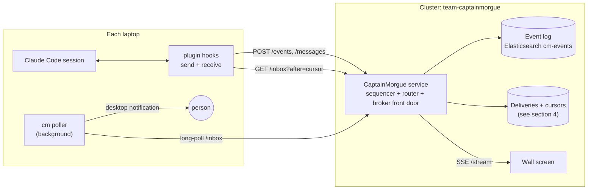
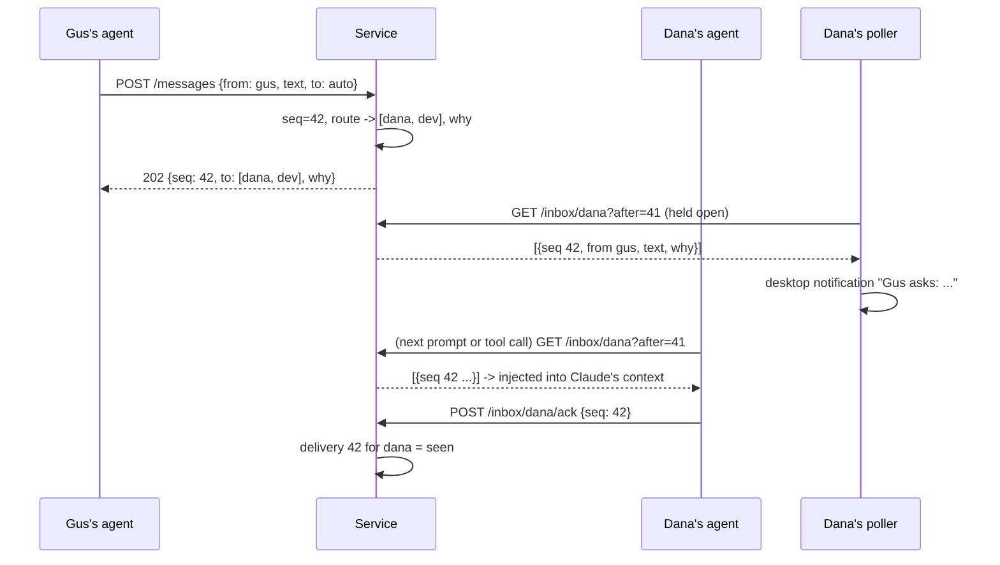
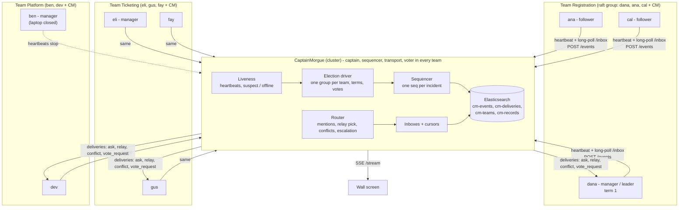
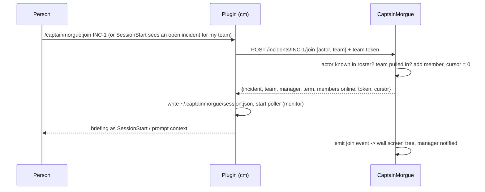
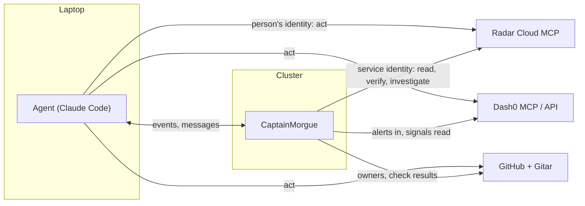

# CaptainMorgue message dispatch

Draft for review. Nothing in here is built yet beyond what section 1 says. Decisions marked **(proposed)** need your yes or no; section 9 lists the questions.

## 1. Where we are, and the gap

What exists on `main` today:

- Agents **send**: the plugin's hooks POST every prompt and tool call to `/events`; `/captainmorgue:broadcast` POSTs to `/broadcast`.
- The service **orders** (one in-memory sequence per incident), **decides** (relay recipients, conflict rule) and **streams** everything to the wall screen over `/stream`.

The gap: **nothing reaches an agent.** A relay names Dana and Dev as recipients, a conflict names Dana and Dev, and neither of their Claude Code sessions ever hears about it. Today dispatch is one-way, laptop to service. The product promise ("CaptainMorgue figures out who should get the message and tells them") needs the other half: a broker every agent can receive from.

## 2. Constraints that shape the design

| Constraint | Consequence |
|---|---|
| Laptops are outside the cluster, often behind NAT, sometimes asleep | Agents must **pull** (poll or hold a connection open). The service can never call a laptop. |
| Only one public entry point: Service `app`, port 80, at `captainmorgue.cnh.radarhq.io` (HTTP through the gateway) | No public broker port (no NATS 4222, no Kafka, no Redis). Whatever broker we pick sits **behind the service**, which is the only door. |
| Cluster budget 2 CPU / 4 GiB requests for everything | A broker must be small, or reuse something already there (CloudNativePG Postgres, Elasticsearch). |
| Claude Code is turn-based: a session only reads new input when a turn starts or a tool finishes | Delivery into the model has to ride on hooks (section 5). An idle session needs a nudge to the human. |
| The URL is public | Anyone can POST as anyone today. Needs at least a team token (section 7). |
| One incident at a time, ~10 people, ~1 event per second at peak | Throughput is not the problem. Ordering, delivery and "did they see it" are. |

## 3. Proposed shape



Three roles in one service **(proposed)**, all behind the one public door:

1. **Sequencer.** Every accepted event gets the next `seq` for its incident. Single writer, so ordering is total and simple. This is the "full ordered record" from the PRD.
2. **Router.** Decides who each event is for: explicit `@mentions`, the relay pick (rule, then Claude), conflict parties, the owning team's manager, and CaptainMorgue's own asks. Writes one **delivery** per recipient.
3. **Broker front door.** Each agent reads its own inbox by cursor. The service is the only thing that talks to storage.

### Message flow, end to end



## 3a. The whole system at a glance



Every arrow is laptop-initiated HTTP to the one public door. Laptops never talk to each other: **CaptainMorgue is the transport for every message, including raft votes**, and it is also one voter in every team.

## 3b. Teams as raft groups

Mapping from the PRD onto Raft, so the election is real but small enough to build today:

| Raft | CaptainMorgue |
|---|---|
| Cluster | One team |
| Voters | Team members + CaptainMorgue (PRD decision). Ticketing = 4 voters, majority 3. Platform = 3 voters, majority 2. |
| Leader | The team's manager. Holds a **lease** renewed by its heartbeats. |
| Term | `term` per team, stored in `cm-teams`, stamped on every manager decision so a stale manager's orders are visibly old. |
| Heartbeat | The poller's held `/inbox` connection plus a `POST /heartbeat` every 5 s. |
| Election timeout | Manager missed 3 heartbeats (15 s) -> **suspect**; 30 s -> lease expired -> election. |
| Log | The team's slice of the incident log. A member's **cursor** (last seq it has seen) is its log index. |
| Vote rule | Grant a vote to a candidate whose cursor is at least as far as yours (Raft's "up-to-date log" rule), one vote per term. In practice: the person who has seen the most of the incident wins. |
| Who asks for votes | CaptainMorgue starts the election (it sees the lease expire), nominates the online member with the highest cursor, sends `vote_request` to the others' inboxes. Each poller answers automatically by the rule; no human click needed. |
| Result | Majority -> `election` event: "Platform elected Dev, term 2, 2 of 3 (Dev, CaptainMorgue)". Wall screen updates the tree. |
| No majority (too few online) | Team folds into its parent team until enough members return (PRD: a one-person team joins the team above). |
| Old manager comes back | Sees a higher term in its first inbox fetch, becomes a follower. Its queued decisions are marked `stale_term` instead of applied. |

Honest framing for the judges: this is **Raft's election and term rules with CaptainMorgue as the network**, not a peer-to-peer Raft log. The log itself is CaptainMorgue's sequence. That is the right call when laptops cannot reach each other.

```mermaid
sequenceDiagram
  participant B as Ben (manager, term 1)
  participant CM as CaptainMorgue
  participant D as Dev
  B--xCM: heartbeats stop (laptop closed)
  Note over CM: +15 s Ben suspect (wall screen: amber)
  Note over CM: +30 s lease expired, Platform term 2
  CM->>D: vote_request (term 2, candidate dev, cursor 118)
  Note over CM: CM votes dev (cursor 118 >= own view)
  D->>CM: vote granted (auto, by rule)
  CM->>CM: 2 of 3 -> dev leads Platform, term 2
  CM-->>D: you now manage Platform; 2 open parts handed to you
  B->>CM: back online, fetch inbox
  CM-->>B: term 2, dev manages; you are a member
```

## 3c. When someone does not respond

| Situation | Detected by | What happens |
|---|---|---|
| Member's laptop asleep / offline | No heartbeat 15 s -> suspect, 30 s -> offline | Wall screen greys them. Messages keep queueing. Their open parts stay theirs for 2 min, then the manager is asked to reassign. |
| Member online but not answering a direct ask | Delivery `delivered` but not `seen` after 60 s (interrupt) or 3 min (inject) | Escalate: to their manager; manager silent too -> to the parent manager -> to CaptainMorgue's dispatch, which pages the next owner of the resource. |
| Manager offline | Lease expiry | Election (3b). |
| Whole team offline | Every member offline | Team folds into parent; parent manager gets the team's open parts. |
| Member returns after a long gap | First inbox fetch with an old cursor | A digest ("37 events, 3 for you, Platform now managed by Dev") instead of 37 injections. |
| Conflict with someone offline | Router sees one party offline | Warning goes to the online party and that person's manager; the offline party gets it on return. |
| CaptainMorgue itself down | Hooks get errors | Hooks spool events to `~/.captainmorgue/spool` and resend on recovery; wall screen reconnects with `Last-Event-ID`; sequencer resumes from max seq in Elasticsearch. No elections while it is down (it is the transport). Single replica for the demo; a second needs a lease before it sequences. |
| Network partition (half the room loses Wi-Fi) | Same as offline, per person | Teams with a majority online keep their manager; others fold up. Rejoin by cursor. |

## 3d. Communication rules

- **Upward by default.** A member's event goes to the incident log; only their manager is *notified*. Managers summarise upward; CaptainMorgue sees everything. Matches the PRD's "dispatch upwards".
- **Sideways only through CaptainMorgue.** `@dana` or `/captainmorgue:broadcast` go to CaptainMorgue, which routes and explains why. No agent-to-agent channel.
- **Broadcasts are scoped by the team tree.** A broadcast to a team reaches every member downstream of it: `registration` reaches Registration and every sub-team under it; the root reaches everyone. CaptainMorgue already knows every connected member (each one holds an inbox poll open), so a broadcast is one delivery per connected member in that subtree, plus queued deliveries for members who are offline. No routing decision, no model call. The Claude relay pick is only for *unscoped* asks ("who knows about confdb?").
- **Downward from managers and CaptainMorgue.** `dispatch` (do this part), `vote_request`, `conflict`, `election` result.
- **Every message carries a reason** (`why`) and a term, so a person can tell who asked and whether that authority is still current.

## 3d-1. Joining an incident

Nobody is in an incident until they join it. Joining is what turns a laptop into a crew member: it starts the heartbeat, opens the inbox, and puts the person in the tree.



- **How you learn there is an incident:** CaptainMorgue opens it (alert, or someone runs `/captainmorgue:open`), pulls in teams by ownership, and every member of those teams who has the plugin installed sees it on their next prompt or session start ("INC-1 is open, Registration was pulled in, run /captainmorgue:join"). The monitor also raises a desktop notification.
- **Auto-join is off** (proposed): a person chooses to join, so the tree shows who is actually working, not who happens to have Claude Code open.
- **Joining a team that is not pulled in yet** is allowed: it pulls the team in, and the manager is notified.
- **First member of a team to join** becomes its manager if the roster has none online (PRD: first to join manages), term 1.
- **Leaving:** `/captainmorgue:leave` hands open parts to the manager, closes the inbox, and if the leaver manages the team, starts an election straight away instead of waiting for the lease to expire.
- **Rejoining** after a crash or a new session: join is idempotent; the server returns the stored cursor, so nothing is missed or repeated.

### Plugin commands

| Command | What it does |
|---|---|
| `/captainmorgue:join [incident] [team]` | Join, start heartbeat and poller, brief the session. Defaults: the open incident, your roster team. |
| `/captainmorgue:leave` | Hand over parts, stop poller, election if you manage. |
| `/captainmorgue:status` | Incident, your team, manager and term, who is online, your unread count, your open parts. |
| `/captainmorgue:inbox` | Show and ack unread messages. |
| `/captainmorgue:broadcast [team] <text>` | Broadcast to a team subtree; no team = your own team; `root` = everyone. Anyone can broadcast to everyone: that is how the room talks. |
| `/captainmorgue:auto on|off` | Auto mode: messages are pushed straight into the session and the agent acts on them without waiting for the person. Off: notify and wait. |
| `/captainmorgue:ask @who <text>` | Direct ask; `@who` can be a person, a team, or omitted to let CaptainMorgue pick. |
| `/captainmorgue:take <part>` | Claim a part of the incident. |
| `/captainmorgue:resolve <part> <how>` | Mark a part resolved; CaptainMorgue checks signals before tagging it. |
| `/captainmorgue:open <title>` | Open an incident by hand (alerts open them automatically). |
| `/captainmorgue:close` | Propose closing; the incident manager confirms. |

Existing hooks keep sending activity. New: `SessionStart` briefs, `UserPromptSubmit` and `PostToolUse` inject unread messages, `Stop` blocks while an interrupt is unread, a monitor runs the poller.

## 3e. Demo beats this enables (all real, nothing faked)

1. Three laptops join three teams; wall screen tree fills in.
2. Gus broadcasts; Dana's Claude session picks it up on her next prompt and her laptop pops a notification.
3. Dana and Dev both act on the checkin rollout; both sessions get the conflict mid-task.
4. Ben closes his laptop. 15 s later amber, 30 s later Platform elects Dev, term 2. Ben opens it again and becomes a member.
5. Dev ignores a direct ask for 60 s; it escalates to his manager and shows on the wall screen.
6. The record lists the election and the escalation alongside the fix.

## 4. Broker options

Everything below sits behind the service, so the agent-facing API does not change with the choice.

| Option | What it gives | Cost here | Verdict |
|---|---|---|---|
| **A. Service + Elasticsearch** (event log already in ES; deliveries as docs keyed `actor+seq`; cursor per actor) | One store, already planned. Durable. Recall works on the same data. | ES is not a queue: reads see writes after refresh (~1 s). Fine for this load. No push, so the service holds long-polls itself. | **Proposed for today.** Least new moving parts. |
| **B. Service + Postgres** (CNPG already in the cluster: `deliveries` table, `LISTEN/NOTIFY` to wake long-polls) | Transactions, exact cursors, instant wake-up. | One more schema; ES still needed for recall, so two stores. | Good if ES refresh lag bites. |
| **C. NATS JetStream in-cluster** (subjects `cm.<incident>.team.<path>.<actor>`, durable consumer per agent) | Real broker: per-consumer ack, redelivery, subject wildcards map neatly onto the team tree (a manager subscribes to `team.registration.>`). | New component in a tight budget (~100m/128Mi works). Laptops still cannot reach it, so the service proxies anyway. | **Post-hackathon path**, and the honest answer to "what replaces the in-process router at scale". |
| D. Redis Streams | Consumer groups, simple. | New component, no win over B or C. | No. |
| E. Kafka | Ordered partitions. | Far too heavy for 2 CPU / 4 GiB. | No. |
| F. A2A between agents directly | What the PRD names. | Laptops cannot reach each other; still needs a relay. A2A becomes the **envelope format**, not the transport. | Keep as the message schema (section 6), not the broker. |

## 5. Getting a message into a Claude Code session

Checked against the Claude Code docs (hooks, channels, plugins reference), 2026-11-09.

| Moment | Mechanism (verified) | What the person sees |
|---|---|---|
| Session starts or resumes | `SessionStart` hook returns `hookSpecificOutput.additionalContext`: your team, manager, term, and a digest of what you missed | Claude opens already briefed |
| Person types a prompt | `UserPromptSubmit` hook (synchronous, ~2 s budget) fetches the inbox, returns messages as `additionalContext` | Claude starts its answer knowing "Gus asked you about confdb at 09:43" |
| Claude is mid-task | `PostToolUse` hook does the same after each tool call | Claude can change course mid-task (stop a restart after a conflict warning) |
| Claude about to stop with an unseen interrupt | `Stop` hook returns `decision: "block"` with the message as `reason`, so Claude keeps going and handles it (capped at 8 continuations) | Claude does not finish its turn while a conflict is unread |
| Session idle | Hooks cannot start a turn. A plugin **monitor** (`experimental.monitors`, starts with the session) runs the `cm` poller, holds `/inbox` open, and raises a desktop notification (OSC 777 terminal sequence or `osascript`) | Person sees "Gus asks you about confdb" and switches to the session |
| Push into an idle session | **Claude Code channels** exist (research preview): an MCP server with capability `claude/channel` pushes `channel` events into an open session; started with `claude --channels plugin:captainmorgue@captainmorgue` (custom channels also need `--dangerously-load-development-channels`); needs claude.ai or Console auth; Team/Enterprise owners must enable it | Claude reacts with no human in the loop. Stretch goal: wire the plugin's MCP server as a channel; fall back to the monitor notification. |

Not available: a plugin cannot ship the main status line, so no unread count there. Async hooks deliver their context on the *next* turn only.

Priority and noise **(proposed)**: conflicts and direct asks interrupt (notification + inject); relays and FYIs inject only; the raw activity of other people is never injected, only shown on the wall screen. Otherwise every agent's context fills with everyone else's tool calls.

## 5b. What an ask looks like in a session (human in the loop)

1. Gus runs `/captainmorgue:ask @dana Is confdb failing over?`. CaptainMorgue delivers it to Dana as `interrupt`; her laptop pops a notification.
2. On Dana's next prompt or tool call, the hook injects the ask with an instruction: show it to Dana verbatim (sender, text, why) and ask her how to answer.
3. If answering needs digging (check confdb, read a rollout), Claude does it **in a subagent**, so Dana's own task is not derailed, and proposes a reply.
4. Dana approves or edits; Claude sends `/captainmorgue:reply <seq> <text>`. The reply goes back to Gus, marks the ask answered, and the wall screen shows the ask as seen and answered.
5. **Fallback is the timeout:** no reply in 60 s -> CaptainMorgue auto-replies to Gus with what Dana is doing right now and escalates to her manager. The wall screen shows the ask amber, then escalated, so it is always clear where an ask stands.
6. If Claude is about to finish its turn with the ask unanswered, the Stop hook holds it once and repeats the instruction.

Auto mode (P1) skips step 4's approval: the agent answers on its own.

## 5a. Connections: agents and CaptainMorgue both reach the outside systems

Two sides hold connections, for different jobs.

| Side | Connections | Used for |
|---|---|---|
| **Each person's agent** (laptop) | Radar Cloud MCP, Dash0 MCP, GitHub, whatever else that person has | Doing the work: reading the cluster, rollouts, logs, opening PRs. The person's own identity and permissions. |
| **CaptainMorgue** (cluster) | Dash0 (MCP or API, service token), Radar (MCP, service identity), GitHub (Gitar check results, CODEOWNERS), Elasticsearch, Claude | Coordinating: opening incidents from alerts, finding owners, checking that a part really recovered, starting the Radar AI investigation, enriching relays and the record. Read-only on the cluster. |



What CaptainMorgue does with its own connections (none of this is built yet):

1. **Open incidents.** A Dash0 alert (webhook or poll) opens the incident and names the affected service.
2. **Find owners.** Team labels from Radar resources and CODEOWNERS decide which teams are pulled in.
3. **Verify progress.** A part is tagged resolved only when CaptainMorgue reads the recovered signal from Dash0 itself, not when someone says so (PRD: progress = signal recovery).
4. **Investigate.** CaptainMorgue starts the Radar AI investigation on the affected workload and posts the finding.
5. **Ground the router.** "Dev is reading confdb right now" comes from Dev's events; "checkin holds most connections" comes from CaptainMorgue's own Dash0 read.

Rule: **agents act, CaptainMorgue reads and verifies.** CaptainMorgue never changes the cluster; it asks a person (or an agent in auto mode) to.

Open: Radar Cloud MCP signs in interactively (OAuth). Whether a service in the cluster can hold its own Radar credential has to be checked with Radar; fallback is the in-cluster Radar API or the Kubernetes API with a read-only ServiceAccount. Dash0 accepts a bearer token, verified for OTLP ingest (region us-west-2).

## 6. Message model

One envelope for everything **(proposed)**, A2A-shaped so swapping in A2A later is a transport change:

```yaml
id: INC-1-42            # incident + seq, also the dedupe key
seq: 42
incident_id: INC-1
ts: 2026-11-09T16:43:40Z
from: gus
to: [dana, dev]          # resolved by the router; empty = record only
kind: ask | relay | conflict | dispatch | fyi | ack | event
text: Is confdb failing over?
why: Dev is reading confdb right now; Dana manages checkin, which holds most connections
reply_to: INC-1-40       # threads
resource: {kind, namespace, name}
priority: interrupt | inject | record
```

Delivery state per recipient: `pending -> delivered (fetched) -> seen (acked by the hook after injection)`. The wall screen can then show "Dana has not seen this yet", which is the thing a coordinator actually wants to know.

Semantics: **at-least-once**, ordered per incident by `seq`, deduped on `id` by the hook. Cursor lives on the server (per actor) and in a file on the laptop (`~/.captainmorgue/cursor`), so a restarted laptop resumes where it left off.

## 7. Things the implementation skipped that this has to answer

- **Identity.** Anyone can POST as anyone. Proposed minimum: one team token per incident in a header, issued at join; actor taken from the token, not the body. GitHub OAuth later.
- **Presence.** The poller's held connection is a heartbeat. No poll for N seconds = offline. That is also the trigger the PRD's manager election needs.
- **Back-pressure.** A laptop that slept for an hour gets a summary ("37 events, 3 for you"), not 37 injections.
- **Service restart.** Event log and cursors reload from storage; the in-memory sequencer resumes from max(seq). One replica only; a second replica needs a lease (ES or Postgres advisory lock) before it sequences.
- **Clock.** Order by `seq`, never by laptop timestamps. Laptop `ts` is kept as "when they did it", server `ts` as "when we knew".
- **Secrets.** Tool output is never sent. Prompt text and Bash commands are, so a pasted key in a command leaks. Scrub on the laptop before send (gitleaks rules) is the PRD answer; today it is not done.
- **Hierarchy.** The PRD has per-team ordered subtrees carried upward and a raft-style manager election. This design is flat (one sequencer). The tree comes back as routing scopes (`team.registration.>`) and as the election's voter set, not as separate logs, until there is a reason to shard.

## 7a. Failure modes of this design

Where this design itself can go wrong, how we notice, and what we do about it. Separate from 3c, which is about people going quiet.

| # | Failure mode | Effect | Detection | Mitigation (today / later) |
|---|---|---|---|---|
| 1 | **CaptainMorgue is a single point of failure**: sequencer, router, transport and a voter in one process | No messages, no elections, no wall screen | Hooks get connection errors; Radar shows the pod down | Hooks spool to disk and resend; one replica restarts fast and reloads from Elasticsearch / lease-based second replica |
| 2 | **Split brain after a restart**: a second replica starts sequencing before the first is gone | Two events with the same seq; two managers in one term | Duplicate `seq` on write | `replicas: 1` and `strategy: Recreate` / lease in ES or Postgres before sequencing |
| 3 | **Elasticsearch refresh lag** (~1 s) | An inbox read misses an event just written | Cursor gaps in tests | Serve inbox from the in-memory tail, ES only for history / Postgres if it bites |
| 4 | **Event lost between append and persist** (crash after ack, before the async ES write) | Hole in the record | seq gap on reload | Write to ES before returning 202 for message kinds; activity events may stay async |
| 5 | **Lost ack** (hook injected the message, ack request failed) | Message shown twice | Duplicate `id` seen by the hook | Dedupe by `id` in `~/.captainmorgue/seen`; at-least-once is the contract |
| 6 | **False suspicion**: laptop on flaky Wi-Fi misses 3 heartbeats | Healthy manager deposed; churn of elections | Elections with the old manager back within seconds | 30 s lease, not 15; randomised election delay; a returning manager with the most-advanced cursor can win the next term back / adaptive timeout |
| 7 | **Thundering herd** on reconnect (whole room back on Wi-Fi) | Burst of long-polls and 37-event digests | Service CPU spike | Digest instead of replay; jittered reconnect in the poller |
| 8 | **No quorum**: team of 2 with one offline (2 of 3 voters needed, only member + CM) | Still elects (member + CM = 2 of 3), fine; team of 3 with 2 offline cannot | Election fails | Fold into parent team (PRD rule) |
| 9 | **CaptainMorgue decides elections alone** in small teams (it is a voter and the transport) | One process effectively picks the manager | By design | Acceptable and stated; the vote rule (highest cursor) is deterministic and auditable in the record |
| 10 | **Clock skew** across laptops | Wrong order if sorted by laptop time | Out-of-order timeline | Order by server `seq` only; laptop time kept as metadata |
| 11 | **Spoofed actor**: anyone with the URL posts as anyone | Fake decisions, fake votes | None today | Team token at join; actor bound to token / GitHub OAuth |
| 12 | **Secrets in prompts or commands** sent to the service | Credential leak into the record and the wall screen | Nothing today | Never send tool output; scrub prompt and command text with gitleaks rules on the laptop / plus server-side scrub |
| 13 | **Context flooding**: injecting every message into every session | Claude loses track of its own task; token cost | Long hook outputs | Inject only `interrupt` and `inject` kinds for that person; cap per turn, link the rest to `/captainmorgue:inbox` |
| 14 | **Hook latency** on every prompt | Typing feels slow | Prompt delay | Inbox read is a local cache filled by the poller; the hook reads the file, not the network |
| 15 | **Idle sessions never see messages** (hooks cannot start a turn) | Ask goes unanswered while the person is in another window | `delivered` but not `seen` | Desktop notification from the monitor; escalation after 60 s / channels push |
| 16 | **Monitors and channels are experimental / research preview** | Feature missing on a teammate's Claude Code version; auto mode unavailable | Join reports no poller / no channel | Fallback: a plain background `cm poll &` started by the join command; auto mode degrades to notify-and-inject |
| 21 | **Auto mode acts on a bad message** (wrong recipient, stale term, spoofed sender) | An agent changes the cluster on someone else's word | Record shows an action triggered by a message | Auto mode never acts on `stale_term` or unknown senders; destructive actions still go through Claude Code's own permission prompts |
| 22 | **Everyone broadcasts to everyone** | Noise; real asks lost | Broadcast rate per person | Root broadcasts are `inject`, not `interrupt`; wall screen groups them |
| 17 | **Model-picked recipients are wrong** for an unscoped ask | Wrong people interrupted | Recipients reply "not me" | Scoped broadcasts need no model; model pick shows `why`, falls back to managers on error |
| 18 | **Conflict rule false positives** (read + write on the same object) | Warnings people learn to ignore | Many conflicts per incident | Read verbs marked by the plugin (`Checked:`); model confirms before sending |
| 19 | **Stale manager acts after losing its lease** (laptop was asleep) | Orders from an old term | Term on every decision | Decisions with an old term are recorded as `stale_term` and not routed |
| 20 | **Public cluster budget** (2 CPU / 4 GiB) | Elasticsearch and the service starve each other | Radar shows OOMKilled / throttling | Elastic Cloud if in-cluster ES does not fit |

## 8. Hackathon cut vs later

| Today (4 h) | Later |
|---|---|
| Option A: service + Elasticsearch, long-poll `/inbox` | NATS JetStream behind the service; per-team subjects |
| Inject on `UserPromptSubmit` and `PostToolUse`; desktop notification from a bash poller | Channels push into idle sessions, if supported; status line unread count |
| Router = explicit `to`, conflict parties, rule-based relay; Claude pick when the key is set | Claude routing with team graph and history |
| Team token in a header | GitHub OAuth, per-person tokens |
| One sequencer, one replica | Lease-based failover; per-team logs if ever needed |
| `ask` / `relay` / `conflict` delivered; everything else record-only | Full priority model, digests for returning people |

## 9. Decisions (2026-11-09)

| # | Question | Decision |
|---|---|---|
| 1 | Push into idle sessions | **Both.** The poller always raises a desktop notification. **Auto mode** (`/captainmorgue:auto on`) also pushes messages into the session through a Claude Code channel, so the agent acts without waiting for the person; the notification is then informational. Auto mode off, or channels unavailable on that laptop: notify and inject on the next prompt or tool call. |
| 2 | Broker today | **Elasticsearch.** Inbox reads come from the service's in-memory tail; Elasticsearch holds history and cursors, so refresh lag does not matter. |
| 3 | Conflicts | **Interrupt:** desktop notification, injected after the next tool call, and `Stop` blocks until Claude has handled it. |
| 4 | Busy person | **Auto-reply.** An ask not seen within 60 s gets an automatic reply from CaptainMorgue built from that person's latest events ("Dana is mid-rollback on checkin, started 09:44"), then escalates to their manager. In auto mode the person's own agent may answer instead. |
| 5 | Root broadcast | **Anyone** can broadcast to everyone. That is how the room communicates. |
| 6 | Auth | **One team token** for the hackathon, in each laptop's keychain and the cluster Secret, sent as a header; the actor must be in the roster. |
| 7 | Wall screen delivery state | **Yes:** relay and ask cards show each recipient as sent, delivered or seen; unseen asks turn amber before escalating. |

## 10. Impact on what is already in flight

- `feat/service-intel` (Elasticsearch storage, Claude relay, record writer): still valid; deliveries and cursors become an extra index there once option A or B is chosen.
- `feat/infra` (cluster): unchanged under option A; option B needs a database and user for CaptainMorgue on the CNPG cluster; option C adds NATS.
- The plugin: gains a receive path (hook output + poller). Send path unchanged.
- The contract in `docs/hackathon-plan.md`: gains `POST /messages`, `GET /inbox/{actor}`, `POST /inbox/{actor}/ack`, and the envelope above. Nothing removed.
