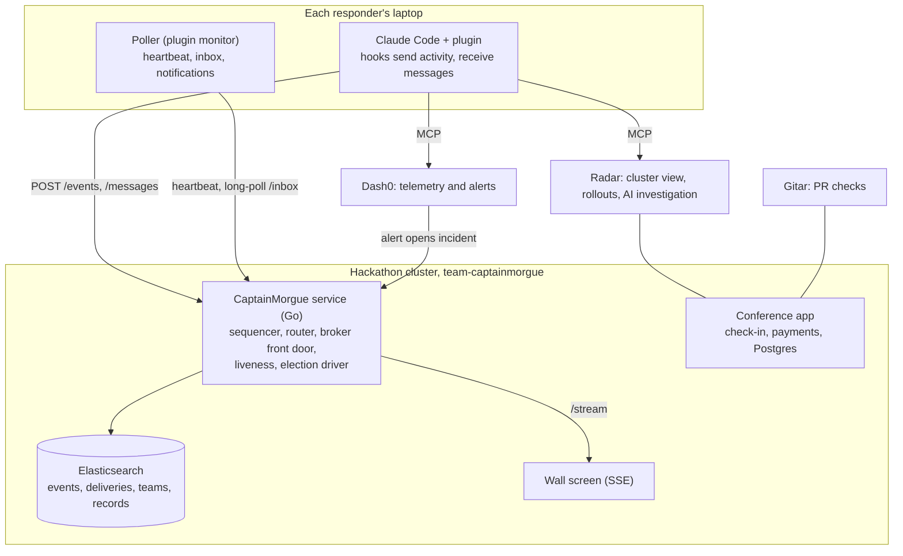

# CaptainMorgue: design overview for review

One page that pulls the design together. Each section links to the doc that holds the detail. Status as of 2026-11-09, early afternoon; demo at 5:30.

## 1. What it is

An incident desk for conference organisers. Every responder runs Claude Code with the CaptainMorgue plugin on their laptop. CaptainMorgue sits at the root of the team tree: it orders everything people and agents do into one record, routes messages to the people who need them, flags conflicting actions, keeps a manager on every team, and writes the incident record when it closes.

Detail: [prd.md](prd.md) (53 decisions, open questions closed with suggestions).

## 2. The system

Key constraints that shape it ([dispatch.md](dispatch.md) section 2):

- Laptops cannot be reached, so everything is laptop-initiated HTTP.
- The cluster has one public door (`https://captainmorgue.cnh.radarhq.io`), so CaptainMorgue is the only way in and carries every message, including election votes.
- Budget: 2 CPU / 4 GiB for the whole team namespace.
- Claude Code reads new input only when a turn starts or a tool finishes.

## 3. Design decisions to review

| Area | Proposal | Detail |
|---|---|---|
| Ordering | One sequencer per incident in CaptainMorgue; order by server `seq`, never laptop clocks | dispatch 3, 7a #10 |
| Broker | CaptainMorgue fronts it; Elasticsearch today, Postgres if refresh lag bites, NATS JetStream later | dispatch 4 |
| Messages | One A2A-shaped envelope; at-least-once, deduped by id; per-recipient `pending / delivered / seen` | dispatch 6 |
| Broadcasts | Scoped by the team tree: every connected member downstream of the team, queued for offline ones; no model call | dispatch 3d |
| Unscoped asks | Router picks recipients (rule, then Claude) and says why | dispatch 3, 3d |
| Joining | `/captainmorgue:join`; told on next prompt or by notification; auto-join off; first in becomes manager | dispatch 3d-1 |
| Into the session | SessionStart briefing; inject on prompt and after tool calls; Stop blocks while a conflict is unread; poller notifies idle sessions; auto mode pushes through a channel | dispatch 5, 9 |
| Teams | Raft-style groups: voters = members + CaptainMorgue; manager holds a lease; heartbeat 5 s, suspect 15 s, election 30 s; vote for the highest cursor; terms on every decision | dispatch 3b |
| Not responding | Suspect, offline, escalate unanswered asks member -> manager -> parent -> CaptainMorgue; digest on return; fold team into parent without quorum | dispatch 3c |
| Communication | Upward by default, sideways only through CaptainMorgue, downward from managers and CaptainMorgue; every message has a why and a term | dispatch 3d |
| Connections | Agents hold MCP connections to act with the person's identity; CaptainMorgue holds its own read-only connections (Dash0, Radar, GitHub) to open incidents, find owners, verify recovery and investigate. Not built yet. | dispatch 5a |
| Failure modes | 20 listed with detection and mitigation; biggest: single point of failure, split brain on restart, false suspicion, spoofed actors, secrets in prompts | dispatch 7a |
| Demo | A real canary release on the conference app, not an injected fault; a real laptop closed for the election | plan 0, dispatch 3e |

## 4. Decisions taken (dispatch section 9)

1. Idle sessions: desktop notification always, plus **auto mode** that pushes messages into the session through a channel so the agent acts on its own.
2. Broker: **Elasticsearch**, inbox served from the in-memory tail.
3. Conflicts **interrupt** (notification, mid-task inject, Stop blocks).
4. Busy people **auto-reply** with their current status after 60 s, then escalate.
5. **Anyone** can broadcast to everyone.
6. **One team token** for the hackathon.
7. Wall screen shows **sent / delivered / seen** per recipient.

## 5. What exists

| Piece | State | Where |
|---|---|---|
| PRD, architecture, dispatch design, build plan | Written; dispatch is a draft for review | `docs/` |
| Design system and playable UI demo | Done | `design/`, `docs/demo.html` |
| Service: events, stream, record, conflict rule, rule-based relay | On `main`, runs locally | `service/` |
| Plugin: activity hooks, broadcast command, demo replay | On `main`, tested in real sessions | `plugin/`, `scripts/replay.sh` |
| Team hooks: commit updates on every prompt, ledger reminder | On `main` | `.claude/settings.json`, `scripts/hooks/` |
| Per-person ledgers | Live; Sammy updating | `ledger/` |
| Service: Elasticsearch storage, Claude relay and record, image build | Crew agent building, not landed | `feat/service-intel` |
| Cluster: conference app, CaptainMorgue deploy, Elasticsearch, Dash0 | Crew agent building, not landed; **Sammy is blocked on it** | `feat/infra` (cluster repo) |
| Join, inbox, heartbeat, elections, plugin commands, poller | Designed, not built, **owner to assign** | plan 5a |
| Wall screen on the live stream | Not started (Jubril) | `web/index.html` |

## 6. Who owns what

| Person | Owns | Ledger |
|---|---|---|
| Emmanuel | Service, coordination design, reviews | [emmanuel](../ledger/emmanuel.md) |
| Jubril | Wall screen | [jubril](../ledger/jubril.md) |
| Sammy | Cluster, Radar, Gitar, canary release, investigation, story | [sammy](../ledger/sammy.md) |
| To assign | Join, inbox, elections, plugin commands, poller (plan 5a) | |

## 7. Risks to the 5:30 demo

1. Plan 5a (join, inbox, elections) is the heart of the coordination demo and has no owner yet.
2. Sammy cannot deploy until `feat/infra` lands and is reviewed.
3. Elasticsearch: local container still pulling; in-cluster vs Elastic Cloud not decided until `feat/infra` reports the budget.
4. Monitors and channels are experimental; the fallback is a background `cm poll`.
5. Real three-laptop rehearsal by 3:00 is the only proof the election and escalation work.

## Docs index

- [prd.md](prd.md): product, decisions, scope
- [architecture.md](architecture.md): components, events, recall, ownership, outside systems
- [dispatch.md](dispatch.md): messaging, joining, elections, liveness, failure modes
- [hackathon-plan.md](hackathon-plan.md): contract, owners, checkpoints
- [../AGENTS.md](../AGENTS.md): how we work together, hooks, ledgers
- [demo.html](demo.html), [../design/index.html](../design/index.html): UI demo and design system

## 8. Where we are at 14:45

Live map: https://claude.ai/artifact/7PedKAvLJhsBNEgHT4fU64. Ranked ideas: [product-ideas.md](product-ideas.md).

### Done

- Service live at `https://captainmorgue.cnh.radarhq.io`: events, stream, record, conflict rule, join, inbox, heartbeat, elections, asks, broadcasts, 60 s auto-reply. Claude is connected.
- Wall screen served from the same URL, fed by `/stream`.
- Plugin on `main`: join, leave, status @person, inbox, broadcast, ask, reply, poller, inject hooks.
- `scripts/e2e.sh` passes locally (8 checks) and against the live URL (4 checks; liveness, election and auto-reply need short timings, so they run locally only).
- Cluster on `main` via Argo: checkin x2, kiosk, confdb, otel-collector, captainmorgue. Images build on every push.
- Team token dropped for the hackathon.

### Integrations, verified on the live cluster

| Integration | State | Evidence | To get it running | Owner |
|---|---|---|---|---|
| Claude | Working | service log `claude=true` | nothing | |
| Elasticsearch | **Not working** | service log: `check index cm-events: ... status code: 401`; the incident is kept in memory only | Create an API key in the serverless project `my-elasticsearch-project-ec8b85` with write on `cm-*`, put it in Secret `captainmorgue` key `elastic-api-key`, restart `captainmorgue`. Check: the log line should read `elasticsearch=true` | Sammy |
| Dash0 | **Not working** | collector log: `Unauthenticated ... invalid authentication token` and `authentication token is blocked`; the token on the cluster is not the one Emmanuel verified | Recreate Secret `dash0` with Emmanuel's verified token and endpoint `ingress.us-west-2.aws.dash0.com:4317`, restart `otel-collector`. Check: no `Exporting failed` lines, and checkin traces visible in Dash0 | Emmanuel gives Sammy the token |
| Dash0 alert opens the incident | Not built | | Dash0 check rule on checkin error rate, webhook to `POST /events` with a `kind: alert` event | Emmanuel |
| Gitar | **Not exercised** | both repos have 0 pull requests; we push straight to `main` | Install Gitar on `tiemma/captainmorgue-cluster`, make the canary change to checkin as a PR, let Gitar review it, merge, Argo rolls it out | Sammy |
| Radar | Working | cluster visible as `captainmorgue`; pods, logs and changes readable | Use Radar AI investigation on the canary in the demo | Sammy |
| payments | Degraded | Running, not ready: Postgres refuses connections | Fix DB host or credentials | Sammy |

### Left before 17:30

1. Elasticsearch and Dash0 credentials fixed (above). Without them there is no recall, no stored record, and no telemetry story.
2. All three on their own agents: the milestone in AGENTS.md. Rehearsal starts when all three tick.
3. Canary release on checkin as a Gitar-reviewed PR; Dash0 sees the regression; Radar investigates.
4. Dash0 alert opens the incident instead of opening it by hand.
5. Plugin auto-install from repo settings (Jubril).
6. Rehearsal with a screen recording, then the story.

### Pieces we can add (from [product-ideas.md](product-ideas.md))

1. Claim before any cluster write: a second agent's write is blocked with the holder's name. 1.5 h.
2. Manager approval for destructive actions through the inbox. 1.5-2 h.
3. Join catch-up digest from the record. 1 h.
4. Recall on open from Elasticsearch, once storage works. 1 h.
5. Agent card at join: role, repo, tools, resources touched, so the router picks the person whose agent can act. About 1 h for the slice.
